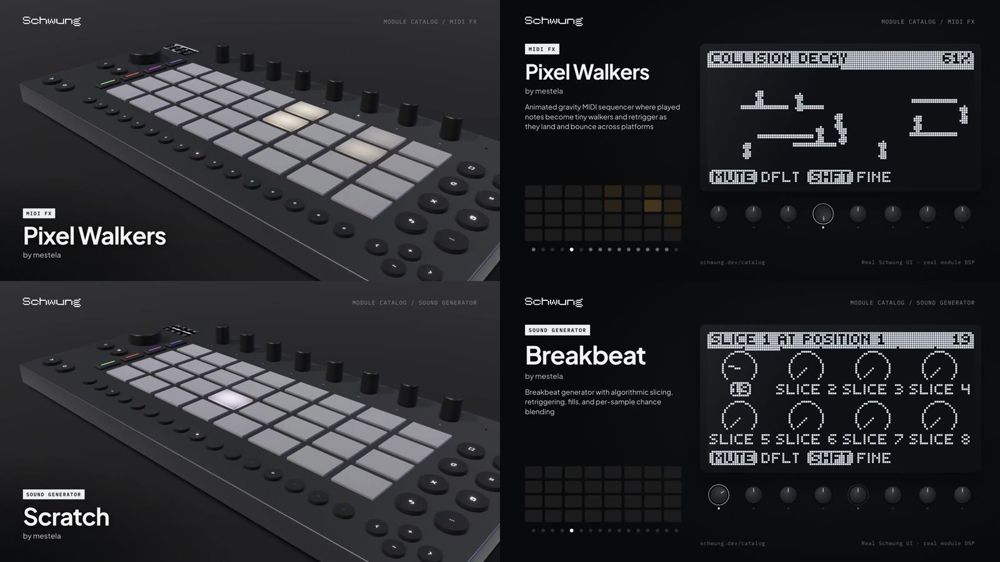

# Ableton Move Demo Recorder

[](https://github.com/Vochsel/ableton-move-demo-recorder/actions/workflows/ci.yml)
[](LICENSE)

Records honest demo videos of [Schwung](https://github.com/charlesvestal/schwung) modules for Ableton Move, without a Move. **[See every module in the gallery →](https://schwung-module-demos.vercel.app)**



For each module it:

1. **Runs the module's real DSP.** The released `dsp.so` (ARM64 Linux) is loaded into a small C host that implements Schwung's plugin API, inside Docker. A score of notes and knob moves is played through it, and the audio is rendered.
2. **Draws the module's real screen.** Every video frame, the host reads the module's parameters back from the running DSP. The OLED is then drawn from that state by Schwung's own renderer, the module's `canvas.js` widgets, or the module's own `ui_chain.js`/`ui.js`. It uses whichever one a Move would show, decided the way Schwung decides it.
3. **Renders two videos with [HyperFrames](https://hyperframes.heygen.com).** One shows the screen up close with pads, steps and encoders; the other is a 3D Move built from Ableton's dimension drawing. The pad lights, knobs and audio all come from the same score, so they stay in sync. Each video is a 12 s seamless loop: 6 bars at 120 BPM.

It also fuzzes the DSPs and UIs and audits the results, so you get a findings report for module authors.

The first run covered the whole Schwung catalog: 158 modules, 316 videos. See [`docs/runs/`](docs/runs/) for the findings.

## Requirements

- macOS or Linux with **Docker**. ARM64 hosts (Apple Silicon) run the modules natively; x86 needs QEMU emulation and is much slower.
- **Node ≥ 20**, **Python ≥ 3.10**, **ffmpeg**, **git**, and the **GitHub CLI** (`gh`, authenticated) to read module repos.
- HyperFrames comes in via `npx` on first render.
- Publishing only: **wrangler** (Cloudflare R2) and **vercel**.

## Quick start

```bash
git clone git@github.com:Vochsel/ableton-move-demo-recorder.git && cd ableton-move-demo-recorder
bin/mdr setup        # clone Schwung into ref/, build the DSP host image, write mdr.config.json
bin/mdr catalog      # fetch the catalog + every release, probe every DSP, build contracts (~15 min)
bin/mdr samples      # render the small sample library the samplers use
bin/mdr record obxd pixel-walkers   # -> out/flat/schwung-<id>.mp4, out/3d/schwung-<id>-3d.mp4
```

`bin/mdr doctor` checks your setup. `bin/mdr help` lists every command.

## Commands

| | |
|---|---|
| `mdr setup` | clone Schwung, build the `schost` image, create `mdr.config.json` |
| `mdr catalog` | catalog + module.json + releases → DSP map → load test → live contract probe → `data/contracts.json` |
| `mdr samples` | sample library (rendered from real Schwung modules) for samplers |
| `mdr record <ids…\|--all>` | data and both videos, local only |
| `mdr data <ids…\|--all>` | plan → probe → score → real-DSP audio + per-frame trace → screen films |
| `mdr render <ids…\|--all> [--publish]` | flat + 3D renders, re-encode + mux audio, posters (+ upload + deploy) |
| `mdr publish` | manifest, gallery deploy, then check (and repair) every upload |
| `mdr recipe <id>` | what a recipe can use for a module: pages, keys, last score |
| `mdr sheets [ids…]` | contact sheets of the screen films (`build/audit/sheets/`) |
| `mdr docs [ids…]` | README + help.json + recipe per module (`build/audit/docs/`) |
| `mdr audit` | automated discrepancy checks (`build/audit/report.md`) |
| `mdr fuzz [ids…] [--iters N]` | random and extreme input at the real DSP (`build/fuzz/report.md`) |
| `mdr fuzz-ui [ids…]` | random and extreme values through every page renderer (`build/fuzz/ui-report.md`) |
| `mdr review-apply` | merge a visual audit's recipes (see the `audit-move-demos` skill) |
| `mdr findings` | `build/FINDINGS.md` for module authors |

## For module authors

If your module's demo doesn't do it justice, a recipe is the fix, and you're the best person to write it. See [CONTRIBUTING.md](CONTRIBUTING.md#1-module-authors-make-your-modules-demo-right). You don't need Docker to suggest one: open a "demo looks wrong" issue and describe how the module should be played.

## Making a demo good: recipes

Without a recipe, a module gets a generic performance chosen from what it is:

- drum machines get a beat, mono synths an arpeggio, poly synths chords;
- arpeggiators get held chords, chord generators single trigger notes;
- effects get a groove played by stand-in instruments.

Knob turns are picked from the pages it shows.

A recipe in `data/recipes/<id>.json` says how the module should actually be played. It can set the notes, the pages, which knobs to turn and how far, and starting values. It can also script jog moves, parameter automation and full-screen canvas dives. See [`docs/RECIPES.md`](docs/RECIPES.md). The 60 recipes from the catalog run are in `data/recipes/`.

## Layout

```
bin/mdr                 the CLI
pipeline/               every step (Python / Node / bash), see docs/ARCHITECTURE.md
pipeline/host/          the headless Schwung plugin host (C) + its Dockerfile
pipeline/custom/        mock Move host that runs a module's own ui.js / ui_chain.js
compositions/flat       HyperFrames composition: the screen up close
compositions/move3d     HyperFrames composition: the 3D Move
site/                   static gallery (manifest-driven)
data/recipes/           per-module demo recipes (tracked)
data/audit/             the catalog run's visual-audit verdicts (tracked)
.claude/skills/         agent skills: record, write recipes, audit, triage
ref/ build/ out/        workspace: Schwung checkout, releases, intermediates, videos (gitignored)
```

## Docs

- [Architecture](docs/ARCHITECTURE.md): the pipeline end to end, and why each step exists
- [Recipes](docs/RECIPES.md): the recipe schema, with worked examples
- [Fuzzing and auditing](docs/FUZZING.md): what each check means, and how to reproduce a finding
- [Publishing](docs/PUBLISHING.md): R2 + Vercel gallery
- [Troubleshooting](docs/TROUBLESHOOTING.md): every trap we fell into, and the fix
- [The catalog run](docs/CATALOG-RUN.md): how all 158 modules were recorded

## Contributing

Recipes, fixes and new checks are all welcome. See [CONTRIBUTING.md](CONTRIBUTING.md); CI runs `bash scripts/check.sh` and builds the ARM64 host.

## Credits

The screens come from [Schwung](https://github.com/charlesvestal/schwung) (MIT) and each module's own code. Every module belongs to its author. This tool downloads their public releases and runs them; it redistributes none of them. Fonts: Plus Jakarta Sans and IBM Plex Mono (OFL). Licensed under Apache-2.0.

This is a community project, not affiliated with or endorsed by Ableton. "Ableton" and "Move" are trademarks of Ableton AG.
